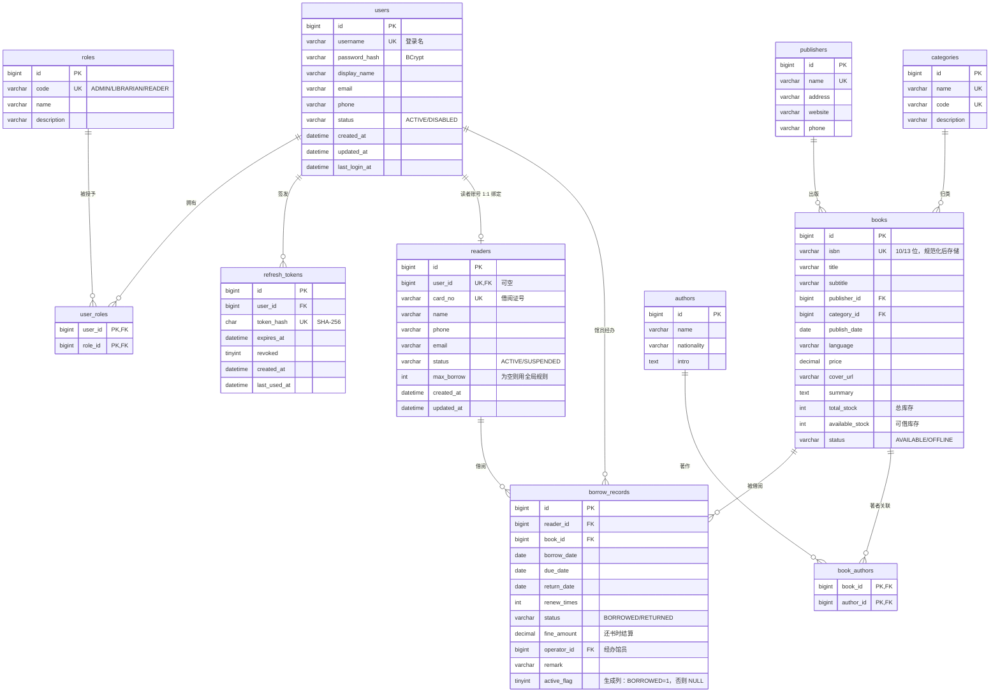

# 数据库设计（ER 图与约束说明）

## ER 图



## 关键设计说明

### 1. 账号与读者的关系

- `users` 负责"能不能登录"（用户名、密码、状态、角色）；`readers` 负责"能不能借书"（借阅证号、联系方式、最大借阅数）。
- 两者通过 `readers.user_id`（唯一、可空）做 1:1 绑定：管理员/馆员账号通常没有读者档案；读者账号登录后通过 `GET /readers/me` 拿到档案。
- 借还书只认 `readers.id`，即使读者账号被停用，历史借阅记录仍然完整。

### 2. 权限模型

- 角色固定三档，存在 `roles` 表并由 `user_roles` 多对多关联，接口用 `hasRole` 做粗粒度授权：
  - `ADMIN`：全部权限，含用户与角色管理；
  - `LIBRARIAN`：图书/主数据/读者/借还/统计；
  - `READER`：图书查询、本人借阅记录、本人档案。
- 用户状态 `DISABLED` 时无法登录，且其 refresh token 会被删除，避免旧令牌继续换发。

### 3. 库存一致性

- 借书不在应用层"先查再改"，而是条件更新一条 SQL：
  ```sql
  UPDATE books SET available_stock = available_stock - 1
  WHERE id = ? AND status = 'AVAILABLE' AND available_stock > 0;
  ```
  影响行数为 0 即说明库存不足或已下架，直接回滚并返回 `42201`。
- 还书对称使用 `available_stock = available_stock + 1 WHERE available_stock < total_stock`，防止异常数据把可借数抬到总库存之上。
- 表上另有 `CHECK (available_stock >= 0 AND available_stock <= total_stock)` 兜底。
- 调整总库存时按"已借出 = 总库存 - 可借库存"重算，不允许把总库存调到已借出数量以下。

### 4. 防重复在借（生成列 + 唯一索引）

```sql
active_flag TINYINT GENERATED ALWAYS AS (IF(status = 'BORROWED', 1, NULL)) STORED,
UNIQUE KEY uk_active_borrow (reader_id, book_id, active_flag)
```

- 同一读者对同一本书，最多一条 `BORROWED` 记录；归还后 `active_flag` 变为 `NULL`，MySQL 唯一索引允许多个 `NULL`，历史记录不受限制。
- 应用层先做一次 `countActiveBorrow` 给出友好提示（`42206`），并发插入时由唯一索引兜底，捕获 `DuplicateKeyException` 后回滚事务。

### 5. 逾期与罚款

- 不落地 `OVERDUE` 状态、也不跑定时任务：逾期是"时间函数"，查询时用 `due_date < CURRENT_DATE` 判定。
- 还书时按 `逾期天数 × fine-per-day` 结算，写入 `borrow_records.fine_amount`；逾期天数按 `return_date - due_date` 计算，未还清的在借记录由查询接口实时计算 `overdueDays` / `currentFine` 供前端展示。
- 规则外置在 `application.yml` 的 `library.borrow.*`，通过 `GET /api/v1/configs/borrow-rules` 暴露给前端：

| 配置项 | 默认值 | 含义 |
| --- | --- | --- |
| `loan-days` | 30 | 借期（天） |
| `max-renew-times` | 2 | 最多续借次数 |
| `renew-days` | 15 | 每次续借延长天数 |
| `max-borrow-per-reader` | 5 | 读者默认最大在借数（读者档案可单独覆盖） |
| `fine-per-day` | 0.50 | 每日罚款（元） |
| `allow-renew-when-overdue` | false | 逾期是否允许续借 |
| `max-fine-amount` | 0 | 罚款上限，0 表示不封顶 |

### 6. 唯一约束与索引

| 表 | 约束 / 索引 | 作用 |
| --- | --- | --- |
| `users` | `uk_users_username` | 登录名唯一 |
| `roles` | `uk_roles_code` | 角色码唯一 |
| `user_roles` | PK(user_id, role_id) | 防重复授权 |
| `refresh_tokens` | `uk_refresh_tokens_hash`、`idx_refresh_tokens_user` | 令牌查找与撤销 |
| `readers` | `uk_readers_card_no`、`uk_readers_user_id` | 借阅证号唯一、账号只绑定一个档案 |
| `books` | `uk_books_isbn`、`idx_books_category`、`idx_books_publisher`、`idx_books_status` | ISBN 唯一与列表筛选 |
| `book_authors` | PK(book_id, author_id)、`idx_book_authors_author` | 多对多关联与作者反查 |
| `borrow_records` | `uk_active_borrow`、`idx_borrow_reader_status`、`idx_borrow_book_status`、`idx_borrow_due_status`、`idx_borrow_borrow_date` | 借阅列表、逾期统计、排行榜 |

所有外键都显式命名了删除策略：关联表 `CASCADE`（授权、令牌、图书-作者），`users` 与 `books` 的弱引用 `SET NULL`，借阅记录对读者/图书 `RESTRICT`（有历史借阅的读者与图书不可物理删除）。

### 7. 时间与中文

- 全部日期用 `DATE`（借期按自然日计算），时间戳用 `DATETIME`；JDBC 时区固定 `Asia/Shanghai`，Jackson 输出 `yyyy-MM-dd HH:mm:ss`。
- 库、表、连接均为 `utf8mb4`，种子数据中的中文在冒烟测试里已做十六进制校验。
